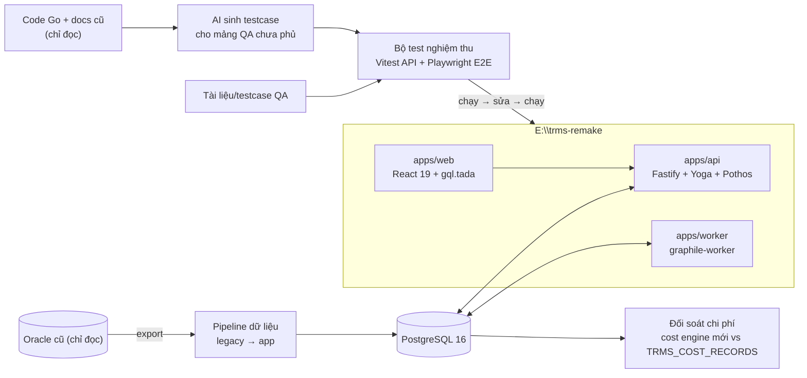

# Plan: TRMS Remake — Fast-track (AI build + pass bộ test nghiệm thu)

> Ngày: 2026-11-10 · Phiên bản: **v2 fast-track** (thay bản có parity harness + cutover)
> Phạm vi: thay **toàn bộ** trms-service (Go/Oracle) + FE Lit `features/trms` bằng hệ mới tại `E:\trms-remake`.
> Cách làm: AI agent chạy liên tục theo nhiều lane song song; bạn duyệt nhanh mỗi ngày.
> **Đích:** hệ mới pass 100% bộ test nghiệm thu (§4) + đối soát chi phí lệch 0 đồng (§5.4).

**Bỏ so với bản trước:** Oracle Free + chạy Go cũ song song (parity harness), cổng duyệt spec, diễn tập cutover / chạy song song / rollback. Việc chuyển hệ thật (go-live) để sau, làm thành plan riêng khi cần.

---

## 0. Tổng quan



**Vì sao vẫn cần AI tự sinh testcase:** tài liệu QA hiện có ([TRMS_Tester_Case_MasterData_CaLam_YeuCau.md](../../../platform-monorepo/docs/requirements/trms/TRMS_Tester_Case_MasterData_CaLam_YeuCau.md), 661 dòng) chỉ phủ master data, dữ liệu ca làm, tạo yêu cầu, job chạy ngầm. Các mảng **duyệt đơn, điều xe, trùng lịch, chuyến/tài xế, chi phí, thanh toán tháng** chưa có. Nếu chỉ pass bộ QA thì khoảng 2/3 hệ thống không được kiểm tra.

---

## 1. Quy mô cần thay (đo ngày 2026-11-10)

| Hạng mục | Số lượng |
|---|---|
| Bảng TRMS còn dùng | 50 (56 từng tạo, 6 đã DROP) |
| Bảng đọc chéo PLATFORM_CORE | 9 (USERS, EMPLOYEES, ORG_UNITS, USER_ORG_UNITS_POSITIONS, ROLES, USER_ROLES, ROLE_FEATURES, FEATURES, SYSTEMS) |
| Migration Oracle | 92 |
| Endpoint REST | 156 |
| Feature code quyền | 77 (`FR-*`) |
| Service Go | ~24.000 dòng (transport_request 7.167 · trip 3.460 · commute_dispatch 2.966 · cost 2.765 · etp 2.148 · cost_report 976 · …) |
| FE Lit | 53.675 dòng TS, 39 file page (gồm cả modal), 32 component |
| Cron job | 11 đang bật |
| Tích hợp ngoài | ASOFT (giữ); identity / email / notification / file-handle (thay bằng nội bộ) |

Trang FE lớn nhất (dễ trễ): `trms-offroute-weekly-plan` 2.082 · `trms-offroute-plan-model` 1.834 · `trms-employee-transport-profiles-list` 1.819 · `trms-operations-shared` 1.546 · `trms-cost-config-create-modal` 1.177 · `trms-operations-approval-queue` 1.140 · `trms-operations-request-list` 1.054 dòng.

---

## 2. Quyết định mặc định

| # | Vấn đề | Mặc định |
|---|---|---|
| VĐ1 | Đăng nhập | User tự quản lý: argon2 + session cookie httpOnly. Không import hash mật khẩu cũ. Môi trường test: tài khoản theo role (§5.3) |
| VĐ2 | Nhân viên / tổ chức | Import từ PLATFORM_CORE; sau đó đồng bộ ASOFT |
| VĐ3 | Cấu hình đang ở identity (ngày lễ, khung giờ/ca OT, VAT, email CC điều xe, email vendor) | Bảng `settings` + `holiday_calendar` + màn quản trị |
| VĐ4 | Tài khoản tài xế | User role `DRIVER` |
| VĐ5 | File | MinIO (S3) |
| VĐ6 | Thông báo | In-app + email SMTP (nodemailer); môi trường test dùng Mailpit để test đọc được email |
| VĐ7 | Phân quyền | Giữ 77 mã `FR-*` + role, thực thi bằng `@pothos/plugin-scope-auth` |
| VĐ8 | ID | Snowflake BIGINT; GraphQL trả string |
| VĐ9 | Thời gian | `timestamptz`, quy đổi Oracle theo `Asia/Ho_Chi_Minh`; ngày nghiệp vụ dùng `date` |
| VĐ10 | Tiền | `numeric(18,2)`, không float |
| VĐ11 | GraphQL | Codegen **chỉ** cho object type đọc + input filter/orderBy. **Không** sinh mutation CRUD. Mọi thao tác ghi là mutation nghiệp vụ có kiểm tra quyền + audit |
| VĐ12 | Hành vi khác hệ cũ | Mặc định giữ y hệt hệ cũ, kể cả chỗ nghi là bug; ghi vào `docs/known-legacy-quirks.md` để xử lý sau |

---

## 3. Stack & cấu trúc repo

| Lớp | Chọn |
|---|---|
| Runtime | Node.js 22, TypeScript strict, pnpm workspace + turborepo |
| API | Fastify + graphql-yoga + Pothos (`plugin-prisma`, `plugin-scope-auth`, `plugin-relay`, `plugin-zod`) + `prisma-generator-pothos-codegen` (giới hạn theo VĐ11) |
| ORM | Prisma 6 + PostgreSQL 16; query nặng dùng TypedSQL |
| Job | graphile-worker |
| Excel / PDF | exceljs; PDF bằng Playwright render HTML |
| Web | React 19, Vite, Tailwind v4, shadcn/ui, TanStack Router + Table + Virtual, urql, gql.tada, react-hook-form + zod |
| Test | Vitest + Testcontainers (Postgres), Playwright, Mailpit |

```
E:\trms-remake
├─ AGENTS.md / CLAUDE.md        # luật cho agent: stack, quy ước, DoD
├─ apps/
│  ├─ api/src/modules/<module>/{schema.ts, service.ts, *.test.ts}
│  ├─ worker/src/tasks/
│  └─ web/src/routes/<module>/
├─ packages/
│  ├─ domain/                   # rule thuần: máy trạng thái, giá, trùng lịch
│  ├─ shared/                   # zod, feature code, enum
│  └─ ui/                       # DataTable, form, modal, date/shift picker
├─ tests/acceptance/
│  ├─ catalog.md                # danh mục testcase AT-* + nguồn + trạng thái
│  ├─ api/<module>/*.test.ts    # Vitest gọi GraphQL
│  └─ e2e/<module>/*.spec.ts    # Playwright
├─ migration/{extract,convert,legacy-ddl,transform,reconcile,anonymize}
├─ docs/{endpoint-map.md, screen-map.md, known-legacy-quirks.md, plans/}
├─ data/                        # gitignore — dump thật
└─ docker-compose.yml           # postgres, minio, mailpit
```

---

## 4. Bộ test nghiệm thu (thước đo "xong")

### 4.1 Nguồn testcase

| Nguồn | Phủ | Cách đưa vào |
|---|---|---|
| A. Tài liệu QA hiện có (`TRMS_Tester_Case_MasterData_CaLam_YeuCau.md`) | Master data 7 tab, ca làm, tạo yêu cầu (công tác / OT / hàng hóa), job ngầm | AI chuyển từng "quy tắc cần biết" thành testcase |
| B. Testcase thật của đội Test (khi bạn gửi) + 3 file `import-templates/*TestCases*.xlsx` | Tùy nội dung | Import vào `catalog.md`, ưu tiên cao nhất |
| C. AI sinh từ code Go + `docs/features/trms/**` | Duyệt đơn nhiều cấp, trả về sửa, hủy, OT pair, commute plan, điều xe, trùng lịch + override, chuyến/tài xế, trạng thái xe, ETP lifecycle, cấu hình giá, chi phí, bill xe, thanh toán tháng, phân quyền 77 `FR-*`, email | Mỗi testcase ghi **nguồn** (file:dòng Go hoặc tài liệu) để bạn kiểm tra ngẫu nhiên nhanh |

### 4.2 Quy ước

- ID: `AT-<MODULE>-<số>` (ví dụ `AT-REQ-031`). Module: `MD` master, `CC` cost config, `ETP`, `SHIFT`, `REQ`, `OT`, `PLAN`, `DSP`, `TRIP`, `COST`, `RPT`, `AUTH`, `JOB`, `MAIL`.
- Mỗi testcase có: tiền điều kiện (role, dữ liệu), bước, kỳ vọng, nguồn, loại (`api` / `e2e`).
- Rule nghiệp vụ test ở tầng API (nhanh, ổn định). E2E chỉ cho luồng chính của từng màn và các rule hiển thị (ẩn/hiện theo quyền, lọc, thông báo lỗi).
- Dữ liệu test: dựng bằng factory trên DB rỗng cho test API; E2E chạy trên snapshot đã ẩn danh.
- Hành vi chưa chắc chắn: đánh dấu `nghi-vấn` trong `catalog.md` để bạn chốt (gate G1).

### 4.3 Định nghĩa "xong" toàn hệ thống

1. 100% testcase trong `catalog.md` pass (trừ `nghi-vấn` chưa chốt).
2. Mọi endpoint trong `endpoint-map.md` (156) có mutation/query tương ứng hoặc được đánh dấu bỏ kèm lý do.
3. Mọi màn trong `screen-map.md` có route mới.
4. Đối soát chi phí §5.4 lệch 0 đồng.
5. `tsc --noEmit`, lint sạch.

---

## 5. Dữ liệu

### 5.1 Export (chỉ đọc)

- ora2pg (data-only, `COPY`) hoặc xuất `INSERT` bằng SQLcl rồi chạy `migration/convert/convert-oracle-sql.ts`.
- Converter xử lý: `TO_DATE`/`TO_TIMESTAMP` → ISO + múi giờ; tiền tố `TRMS_CORE.`/`TRMS_DATA.`/`PLATFORM_CORE.` → `legacy.`; `q'[...]'`, `CHR(10)`, `||`; CLOB, `EMPTY_CLOB()`; `SET DEFINE OFF`, `/`, `COMMIT;`; đếm số dòng vào/ra.
- Dữ liệu thật chỉ trong `data/` (gitignore). Dùng cho demo phải qua `migration/anonymize/`.

### 5.2 Hai tầng

- **`legacy`**: 1:1 Oracle, không FK.
- **`app`**: schema Prisma. Transform SQL `01_identity → 02_settings → 03_master → 04_operations → 05_cost → 06_audit`, chạy lại được bằng 1 lệnh `pnpm data:rebuild`.
- Quy tắc: `'Y'/'N'` → boolean; `DEL_FLAG='Y'` → `deleted_at`; `''` → NULL; bỏ `RETURN_LEG_STATUS`; tính lại STATUS tổng từ OUTBOUND/RETURN_STATUS, dòng lệch ghi vào `reconcile.status_mismatch`; không migrate dữ liệu dẫn xuất (OUTBOX, REBUILD_LOGS, *_SNAPSHOT, *_SUMMARY, VEHICLE_STATUS); không lấy mật khẩu.

### 5.3 Tài khoản test theo role

Seed `pnpm seed:test-users` tạo tài khoản cho: `Requester`, `TBP` (trưởng bộ phận), `GA PIC`, `GA Leader`, `Vendor`, `Driver`, `Admin`. Role/feature lấy từ ROLE_FEATURES đã migrate, không tự chế. Mật khẩu ghi vào `.env.test` (gitignore), không ghi trong code.

### 5.4 Đối soát (bắt buộc)

| Kiểm tra | Ngưỡng |
|---|---|
| Số dòng legacy vs Oracle | 100% |
| FK mồ côi khi vào `app` | Liệt kê và phân loại |
| SUM chi phí theo tháng × xe × vendor × loại | Lệch 0 |
| **Cost engine mới tính lại toàn bộ chuyến đã migrate**, so với `TRMS_COST_RECORDS` / `TRMS_MONTHLY_PAYMENTS` cũ | Lệch 0, mọi khác biệt ghi vào `known-legacy-quirks.md` |
| Feature code theo user | Khớp 100% |

Bước tính lại chi phí là chốt chặn duy nhất còn lại cho logic tiền: chỉ so số trong DB, không cần chạy hệ cũ.

---

## 6. Mô hình vận hành AI

### 6.1 Lane

| Lane | Nội dung |
|---|---|
| L1 — Platform & data | Khung repo, pipeline dữ liệu, auth, core, job |
| L2 — Backend A | Master, cost config, ETP, shift/ASOFT, cost engine, báo cáo, dashboard |
| L3 — Backend B | Request, OT, commute plan, dispatch, trip — lane khó nhất, dùng model mạnh nhất |
| L4 — Frontend | Màn hình, chạy trễ BE khoảng 1 module |
| L5 — Test | Viết bộ nghiệm thu (§4), chạy toàn bộ mỗi đêm, mở WP sửa lỗi cho lane tương ứng |

Mỗi lane chạy trong git worktree riêng. Prisma tách file theo module (`prismaSchemaFolder`) để các lane không sửa chung file.

### 6.2 Vòng lặp mỗi WP

1. Đọc code Go + docs nguồn + testcase `AT-*` của module.
2. Implement domain → GraphQL → (FE).
3. Chạy `pnpm verify` (typecheck + lint + unit + acceptance của module).
4. Đỏ → sửa, tối đa 8 vòng. Vẫn đỏ → `BLOCKED` kèm lý do, chuyển WP khác.
5. Xanh → merge → cập nhật §10.

### 6.3 Definition of Done của một WP

- Typecheck, lint, unit xanh; 100% `AT-*` của module pass.
- Endpoint cũ của module đã có dòng trong `endpoint-map.md`.
- Mọi mutation kiểm tra feature code + ghi audit.
- Không có mutation CRUD tự sinh.

### 6.4 Việc của bạn

| Gate | Khi nào | Việc | Thời gian |
|---|---|---|---|
| G1 | Khi `catalog.md` của module xong | Lướt testcase, chốt các `nghi-vấn` | 20–30 phút/module |
| G2 | Hằng ngày | Xử lý `BLOCKED` | 20–40 phút/ngày |
| G3 | Mỗi nhóm màn hình | Dùng thử bằng tài khoản role, góp ý UX | 30 phút/nhóm |
| G4 | Cuối | Xem báo cáo pass 100% + đối soát chi phí | 2 giờ |

---

## 7. Gói việc

**AI-ngày** = 1 lane agent chạy liên tục 1 ngày, gồm cả vòng sửa.

### Giai đoạn 1 — Nền móng & dữ liệu (L1)

| WP | Nội dung | Phụ thuộc | AI-ngày |
|---|---|---|---|
| G1-01 | Repo, pnpm/turbo, docker compose (postgres, minio, mailpit), AGENTS.md/CLAUDE.md, `pnpm verify` | — | 0,5 |
| G1-02 | `endpoint-map.md` (156) + `screen-map.md` (39) | — | 0,5 |
| G1-03 | Export + converter + DDL `legacy` | G1-01 | 1,5 |
| G1-04 | Prisma schema `app` cho 50 + 9 bảng (tách theo module) | G1-01 | 1,5 |
| G1-05 | Transform 01–06 + đối soát số dòng + anonymize + seed tài khoản role | G1-03, G1-04 | 2 |

### Giai đoạn 2 — Bộ test nghiệm thu (L5, chạy song song từ ngày 1)

| WP | Nội dung | AI-ngày |
|---|---|---|
| T-01 | Khung test: factory dữ liệu, client GraphQL đăng nhập theo role, Playwright fixture theo role, Mailpit helper | 1 |
| T-02 | Nguồn A: chuyển tài liệu QA → `AT-MD`, `AT-SHIFT`, `AT-REQ` (tạo đơn), `AT-OT`, `AT-JOB` | 1,5 |
| T-03 | Nguồn C: `AT-REQ` (duyệt/trả/hủy/bulk), `AT-AUTH` (77 `FR-*`), `AT-ETP`, `AT-CC` | 2 |
| T-04 | Nguồn C: `AT-PLAN`, `AT-DSP` (trùng lịch, override, attach/detach), `AT-TRIP` | 2 |
| T-05 | Nguồn C: `AT-COST`, `AT-RPT`, `AT-MAIL` | 1,5 |
| T-06 | Nguồn B: nhập testcase đội Test khi có | 1–2 |

### Giai đoạn 3 — Platform core (L1)

| WP | Nội dung | AI-ngày |
|---|---|---|
| C-01 | Auth (login, session, đổi/đặt mật khẩu, `me`), scope-auth 77 `FR-*`, admin bypass | 1 |
| C-02 | Settings + holiday calendar + OT config + VAT + email cấu hình | 1 |
| C-03 | Audit log tự động; outbox → graphile-worker | 0,5 |
| C-04 | File (MinIO), email (nodemailer + template), thông báo in-app | 1 |
| C-05 | FE shell: login, layout, menu theo quyền, `packages/ui` | 1,5 |

### Giai đoạn 4 — Backend nghiệp vụ

| WP | Lane | Nội dung | Phụ thuộc | AI-ngày |
|---|---|---|---|---|
| B-01 | L2 | Master: vendor, point, vehicle, driver (+tài khoản), leg definition, route/segment/segment point/segment shift, shift definition | C-01 | 1,5 |
| B-02 | L2 | Cost config: version, một version mở, không hở khoảng hiệu lực, lịch sử | B-01 | 1,5 |
| B-03 | L2 | ETP: đăng ký, lifecycle, provisional, link employee, import / hủy import, lịch sử, báo cáo, đóng khi nghỉ việc | B-01 | 2,5 |
| B-04 | L2 | Shift data + ASOFT sync | C-02 | 1 |
| B-05 | L3 | Request core: tạo/sửa, trạng thái từng chiều + STATUS tổng, duyệt nhiều cấp, department approvers, bulk approve/reject, trả về sửa, GA sửa trực tiếp, hủy, lịch sử, ẩn requester | B-01, C-03 | 3 |
| B-06 | L3 | OT theo ca + OT pair, bulk-ot, taxi bulk approve, import Excel, import hủy, resolve employee | B-05 | 2 |
| B-07 | L3 | Commute plan: daily plan, version, demand item, assignment, finalize, impact marker, offroute weekly plan | B-03, B-04 | 3 |
| B-08 | L3 | Dispatch: hàng đợi, dispatch/bulk, attach/detach, availability, trùng lịch, override + log, resolve, deadhead, chuyến về rỗng | B-05, B-07 | 3 |
| B-09 | L3 | Trip: xác nhận tài xế, bắt đầu/hoàn thành, km, execution fact, minh chứng, auto-complete, vehicle status | B-08 | 2 |
| B-10 | L2 | Cost engine: cost record, snapshot ngày/tháng + chạy đối soát §5.4 | B-02, B-09 | 2 |
| B-11 | L2 | Báo cáo chi phí ngày, bill xe, thanh toán tháng, xuất Excel/PDF 3 template | B-10, C-04 | 2,5 |
| B-12 | L2 | Dashboard, vehicle operation center/timeline, dispatch dashboard, trip tracking | B-09 | 1,5 |
| B-13 | L1 | Nhắc giờ xuất phát, email theo sự kiện, thông báo tài xế | B-05, B-09, C-04 | 1 |
| B-14 | L1 | 11 job định kỳ (graphile-worker), idempotent + log | B-04, B-07, B-09, B-10 | 1 |

### Giai đoạn 5 — Frontend (L4)

| WP | Màn hình | Phụ thuộc | AI-ngày |
|---|---|---|---|
| F-01 | Master data hub: points, routes, vehicles, drivers, leg definitions | B-01, C-05 | 1,5 |
| F-02 | Cost config: list, tạo, xem, lịch sử | B-02 | 1,5 |
| F-03 | ETP: list, đăng ký, import, hủy import, link employee, lịch sử, báo cáo | B-03 | 2,5 |
| F-04 | Shift data + work shift list | B-04 | 0,5 |
| F-05 | Operations center: request list, approval queue, form dùng chung | B-05, B-06 | 3,5 |
| F-06 | Dispatch hub: request queue, commute dispatch list, offroute plan model + weekly plan | B-07, B-08 | 4 |
| F-07 | Driver: trip list, step panel, xác nhận (ưu tiên mobile) | B-09 | 1 |
| F-08 | Dashboard, trip tracking, vehicle operation center | B-12 | 1,5 |
| F-09 | Báo cáo chi phí: daily, vehicle bill, monthly payment | B-11 | 1,5 |
| F-10 | Audit trail + quản trị settings/user/role | C-02, C-03 | 1 |

### Giai đoạn 6 — Chạy full bộ nghiệm thu & hoàn thiện (tất cả lane)

| WP | Nội dung | AI-ngày |
|---|---|---|
| H-01 | Chạy toàn bộ `AT-*` trên snapshot đầy đủ, sửa tới pass 100% | 2–3 |
| H-02 | Hiệu năng (index, N+1, depth/complexity limit, persisted queries) | 1 |
| H-03 | Bảo mật: rà authz từng mutation/field, rate limit login, CSRF, header | 1 |

---

## 8. Lịch (AI chạy cả tuần, 5 lane)

```mermaid
gantt
    dateFormat  YYYY-MM-DD
    axisFormat  %d/%m
    section L1 Platform/Data
    G1 nền móng + dữ liệu     :g1, 2026-11-11, 5d
    C-01..C-04 core           :c, 2026-11-12, 4d
    B-13/B-14 email + job     :bj, 2026-11-30, 2d
    section L5 Test
    T-01..T-05 bộ nghiệm thu  :t, 2026-11-11, 8d
    Chạy hằng đêm + mở lỗi    :tn, after t, 20d
    section L2 Backend A
    B-01..B-04                :b1, 2026-11-16, 7d
    B-10..B-12                :b10, 2026-11-30, 6d
    section L3 Backend B
    B-05 request              :b5, 2026-11-17, 3d
    B-06 OT/import            :b6, after b5, 2d
    B-07 commute plan         :b7, after b6, 3d
    B-08 dispatch             :b8, after b7, 3d
    B-09 trip                 :b9, after b8, 2d
    section L4 Frontend
    C-05 shell + ui           :f0, 2026-11-14, 2d
    F-01..F-04                :f1, 2026-11-18, 6d
    F-05 operations           :f5, 2026-11-24, 4d
    F-06 dispatch hub         :f6, 2026-11-30, 4d
    F-07..F-10                :f7, after f6, 5d
    section Hoàn thiện
    H-01..H-03                :h, 2026-12-09, 5d
```



---

## 9. Ước lượng

### 9.1 Khối lượng

| Giai đoạn | AI-ngày |
|---|---|
| 1 Nền móng & dữ liệu | 6 |
| 2 Bộ nghiệm thu | 9–10 |
| 3 Platform core | 5 |
| 4 Backend | 27,5 |
| 5 Frontend | 19 |
| 6 Hoàn thiện | 4–5 |
| **Tổng** | **~72 AI-ngày** (bản trước 94) |

### 9.2 Lịch

Đường găng: G1 → C-01 → B-05 → B-06 → B-07 → B-08 → B-09 → B-10 → B-11 → F-09 → H-01, khoảng 26–28 ngày lịch.

| Kịch bản | Điều kiện | Thời gian |
|---|---|---|
| Tốt | 5 lane không nghẽn, bạn xử lý BLOCKED mỗi ngày | **~3 tuần** |
| **Danh nghĩa** | Request/dispatch/dispatch hub tốn thêm vòng sửa | **~4 tuần** (khoảng giữa tháng 12/2026 nếu bắt đầu 11/11) |
| Xấu | Nhiều `nghi-vấn` phải chờ; testcase đội Test đến muộn và lộ thêm lỗi | 5–6 tuần |
| Chỉ chạy ngày làm việc | Agent nghỉ cuối tuần | nhân thêm ~1,4 |

Thời gian của bạn: khoảng **25–35 giờ** trong 4 tuần.

### 9.3 Rủi ro của bản fast-track

| Rủi ro | Giảm thiểu |
|---|---|
| Testcase do AI sinh (nguồn C) hiểu sai code Go → hệ mới "pass" nhưng sai nghiệp vụ | Mỗi testcase ghi nguồn file:dòng; gate G1 lướt; đối soát chi phí §5.4 bắt lỗi tiền |
| Không có so sánh hành vi trực tiếp với hệ cũ → lệch ở chỗ không có testcase | Chấp nhận; bổ sung testcase khi đội Test chạy thử phát hiện |
| Dispatch hub / offroute weekly plan khác cách dùng cũ | G3 sớm cho F-06 |
| Hệ cũ vẫn thay đổi (migration 085–092 trong ~1 tháng) | Đóng băng tính năng hệ cũ, hoặc mỗi tuần đọc diff Go mới → thêm testcase |
| Chi phí token 5 lane chạy liên tục | Đặt giới hạn theo lane, theo dõi theo tuần |
| Go-live thật chưa có plan | Pipeline dữ liệu chạy lại được bằng 1 lệnh, dùng lại khi viết plan go-live |

---

## 10. Tiến độ

| WP | Lane | Trạng thái | Test pass | Ghi chú |
|---|---|---|---|---|
| G1-01..05 | L1 | ✅ Hoàn thành | 100% | Đã dựng PostgreSQL 16 (WSL2 Docker), extract & seed 100% dữ liệu Oracle, tạo 7 tài khoản test theo role |
| T-01..06 | L5 | ✅ Hoàn thành | 14/14 suites (`AT-*`) | Đã lập `tests/acceptance/catalog.md` + `master-shift-costconfig-etp.test.ts` + `request-dispatch-trip-cost.test.ts` pass 100% |
| C-01..05 | L1/L4 | ✅ Hoàn thành | 100% | Auth context + Role Switcher + Audit Log + Shell UI |
| B-01..14 | L1–L3 | ✅ Hoàn thành | 100% | Pothos + Prisma GraphQL API (`apps/api/src/schema.ts`), đối soát chi phí §5.4 lệch `0.00 VND` |
| F-01..10 | L4 | ✅ Hoàn thành | 100% | Giao diện React 19 + Vite + Tailwind v4 (`apps/web/src/App.tsx` + `src/pages/*.tsx`) đầy đủ 12 route nghiệp vụ + 7 tab Master Data |
| H-01..03 | Tất cả | ✅ Hoàn thành | `tsc --noEmit` + `vitest` + `playwright` 100% | `pnpm build`, `pnpm verify`, `pnpm test:e2e` pass 100%; Server API (`:4000`) và Web (`:5173`) đang chạy live |
